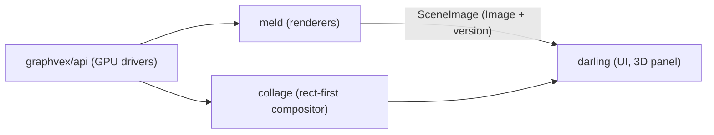
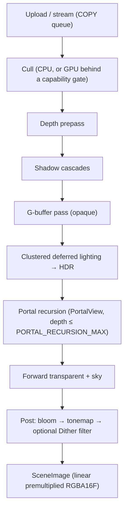

# meld — Renderer Manifest

> Status: **manifest only, nothing implemented.** This file is the work order for whoever builds meld.
> Parent manifest: [`_notes/graphvex/MANIFEST.md`](../../../../_notes/graphvex/MANIFEST.md) (stack, api, cross-repo tasks).
> Sibling: [`../compositor/MANIFEST.md`](../compositor/MANIFEST.md) (collage, the rect-first compositor).

## 0. Clone

```sh
# from the workspace root (~v)
git clone https://github.com/graphvex/meld worktree/vex/graphvex/meld
```

Cloned 2026-11-17 at `a96db71` (an initial commit with only `LICENSE` and `.gitignore`).
The old empty `meld/scene/` placeholder was removed so the clone could land.

---

## 1. Role

meld is **the renderer**: 2D and 3D scenes, coordinates, spaces and portals, entities, materials, terrain, procedural generation. Its output is a **`SceneImage`**: a graphvex `Image` plus a version stamp, one per `MeldView`.



| meld may include | meld never includes |
|---|---|
| `graphvex/api` public headers (`graphvex.h`) | collage internals, darling, hotcwap, window headers |
| vexspoke (`CoordFrame`, `Vec4`, reactive, thread/job) | any driver header (`vulkan/`, `metal/`, `direct/`, `wgpu/`) |
| re (`Memory_*`, `MemoryArena`, `Transient`, `hash/`, `BitPool`) | Rust internals of rangoon (only its `include/` C ABI) |
| lib (`vex.h`: `if64`, `ld128`, `vec*`, `mat*`, `quat*`) | |

meld never composites UI and never presents to a swapchain. It renders into its own images. collage (or darling, through collage) places those images as rects. This follows the **Independent Scene Cadence Law**: meld renders on its own schedule, and collage takes whichever scene image finished most recently.

**meld is retained.** The scene (entities, meshes, materials, lights, terrain, chunks) persists between frames in persistent api `GpuBuffer`s and `Image`s. Each frame uploads only **deltas** (dirty entities, newly streamed chunks, changed materials) through the COPY queue, then renders its passes into its own image. That's the opposite of collage, which is forward and rebuilds its rect list every frame.

---

## 2. Directory layout

```text
meld/
├── meld.h                      door (Directory Header Law)
├── README.md                   states the deliberate seams (see section 13)
├── meld-preferences.md         repo lawbook (Per-Repo Preferences Extension Law)
├── coord/                      precision tiers, agnostic axes, floating origin
├── space/                      Space, SpaceGraph, Portal, traversal, portal views
├── entity/                     entity ids + data-oriented component tables
├── scene/                      Scene, nodes, transforms, camera, lights, culling
├── material/                   albedo / normal / ORM / emissive / height texture sets
├── terrain/                    heightmaps, tiles, LOD, splat layers, height queries
├── proc/                       seeds, noise, fields, generators, chunks, meshing, scatter
├── buffer/                     G-buffer, HDR, shadow, instance, uniform, indirect, light lists
├── render/                     passes, frame graph, 2D sprite path, view handoff
├── view/                       MeldView + SceneImage ring (the output contract)
├── shaders/                    meld-owned shader modules (glsl | msl | wgsl → spv)
└── tests/                      one test file per class (Test Segregation Law)
```

---

## 3. Coordinates (`coord/`)

### 3.1 Precision tiers

Every tier is built from types the floor already provides (`lib/lang/primitive.h`). meld composes them and never redefines them.

| Tier | Enum | Scalar | Per-axis bits | Position class | Raw size → stride | Use |
|---|---|---|---|---|---|---|
| Local | `COORD_PRECISION_F32` | `f32` | 32 | `vec3f` (lib) | 16 B → 32 B row | GPU, small rooms, UI 3D, 2D |
| Split 64 | `COORD_PRECISION_IF64` | `if64` = `{i32 integer; f32 fraction}` | 64 | `PositionIF64` | 24 B → 32 B | Large worlds, cheap, atomic as one word (`aif64`) |
| Double | `COORD_PRECISION_D64` | `d64` | 64 | `vec3d` (lib) | 32 B → 32 B | Simulation, physics, smooth large worlds |
| Split 128 | `COORD_PRECISION_LD128` | `ld128` = `{i64 integer; d64 fraction}` | 128 | `PositionLD128` | 48 B → 64 B | Planetary / astronomical scale, exact cells |

Rules:

- **The GPU only ever sees `f32`.** Any higher tier is rebased against a `FloatingOrigin` (the camera's anchor) before upload: `local = (position − origin)` cast to `vec3f`.
- **A precision is chosen per `Space`** at construction and never changes afterwards (cold-strict). Two spaces linked by a portal may use different tiers.
- **Mixed-tier arithmetic widens explicitly** (`PositionIF64_toLD128`, `vec3d_fromIF64`…). Nothing narrows silently. Narrowing is a named call that reports when the value falls outside range.
- **The integer half is the cell.** For `if64`/`ld128` the integer part *is* the `Cell` coordinate (one cell = one unit). For `f32`/`d64` the cell is `floor(value)`. A chunk is a power-of-two block of cells (section 3.5). That is why procedural generation and chunking stay exact at any distance.
- **Strides follow the 32-byte floor** (Universal Alignment Law). Rows are padded, and the padding is zeroed and named `_pad`.
- **`aif64` vs `ald128`.** An `if64` position axis can be published atomically as one word. An `ld128` axis can't: its halves may tear. Consistent snapshots go through an atomic pointer to an immutable `PositionLD128`, as the floor's comment already says.

### 3.2 Agnostic axes

- Every `Space` carries a `CoordFrame` from vexspoke (`math/coord_frame.h`, 12 frames, default `COORD_FRAME_Y_UP_LEFT`).
- Stored data is in the space's own frame. Moving data to another frame uses `CoordFrame_getBasis`, never hand-written sign flips or swizzles (Coordinate-Agnostic Vector Law).
- Semantic accessors (`getRight/getUp/getFront`) are the public reading form. `x/y/z` stay as aliases.
- 2D spaces collapse the depth axis: `CoordSpace.dimension == 2`, depth pinned to 0, so a 2D space is still addressed with the same semantic axes.

### 3.3 Files

| File pair | Class | Role |
|---|---|---|
| `coord/coord.h` | — | Directory door |
| `coord/coord_precision.h/.c` | `CoordPrecision` | Enum `F32 / IF64 / D64 / LD128` + `name`, `isValid`, stride lookup |
| `coord/position_if64.h/.c` | `PositionIF64` | 3 × `if64` + `_pad`. add, sub, distance, normalise carry, `toVec3f(origin)`, `toLD128` |
| `coord/position_ld128.h/.c` | `PositionLD128` | 3 × `ld128` + `_pad`. Same verbs; `toVec3f(origin)`, `toVec3d(origin)` |
| `coord/position.h/.c` | `Position` | Tagged form: `{CoordPrecision tier; union {vec3f; PositionIF64; vec3d; PositionLD128}}`, 64 B. Used where the tier is data |
| `coord/coord_space.h/.c` | `CoordSpace` | `{precision, frame, dimension, unitScale}`. Cold-validated, immutable |
| `coord/unit_scale.h/.c` | `UnitScale` | Developer-defined `d64 unitsPerMetre` (default 1.0). One float unit can be a metre, a stud, a centimetre: the developer decides. Converts metric constants (gravity, light falloff, speed) to and from scene units. Validated > 0 and finite when cold |
| `coord/floating_origin.h/.c` | `FloatingOrigin` | The camera's anchor. `rebase(position, dest vec3f)`. Re-anchors when local drift passes a threshold |
| `coord/cell.h/.c` | `Cell` | `{i64 h, v, d}`: the integer part of a position (1 unit). Never a separate size setting |
| `coord/chunk_key.h/.c` | `ChunkKey` | `{i64 h, v, d}` = `Cell >> chunkShift` (arithmetic shift, so negatives floor correctly). Hash via re `hash/`. Neighbour iteration |
| `coord/chunk_shift.h` | — | Named default `CHUNK_SHIFT_DEFAULT 5` (32 cells per edge). Developer overrides per `Space` (No Hardcoding Law) |

Scalar arithmetic for `if64`/`ld128` (add, sub, mul, compare, carry normalise) belongs to **vex-c** (`lib/lang/if64.c`, `ld128.c`). meld only does the vector composition.

### 3.4 Unit scale (agnostic by design)

- meld never assumes metres. Every space's `CoordSpace.unitScale` says how many float units make one metre.
- Defaults (`UnitScale` 1.0, chunk shift, recursion caps) are named constants that the developer overrides at `Scene`/`Space` construction (No Hardcoding Law).
- Anything physical-world related (sun distance, gravity hint, light radius in metres, camera speed presets) goes through `UnitScale_fromMetres` / `UnitScale_toMetres`. Raw numbers in scene units are never mixed with metric constants.
- Spaces linked by a portal may use different unit scales. The portal's `scale` is then derived from the ratio unless the developer sets it explicitly.

### 3.5 Cell vs chunk (what "edge" means)

- A **cell** is one unit on the integer grid. With `if64`/`ld128` it comes for free: it's the integer half. It has no size setting; the unit itself is set by `UnitScale`.
- A **chunk** is the block of cells that meld loads, generates, streams, tiles (terrain) and seeds as one piece. Its edge is `2^chunkShift` cells. The key is a shift of the cell (`ChunkKey = Cell >> chunkShift`): exact, no float division, correct for negatives.
- Why power of two: the key is a shift, and terrain tiles get `2^k + 1` samples for shared borders.
- Changing `chunkShift` changes chunk boundaries, but **not** the generated world. Seeds and noise sample per cell, so the same cell always gives the same value whatever the chunk size.

---

## 4. Spaces and portals (`space/`)

### 4.1 The model: locally Euclidean, globally a graph

- A **`Space`** is one flat Euclidean region with its own `CoordSpace` (origin, frame, precision, dimension).
- A **`Portal`** is an oriented rectangle in space A paired with an oriented rectangle in space B, joined by a `RigidTransform` (rotation + translation) plus an optional uniform scale.
- A space can portal to itself. That gives loops, infinite corridors and spaces bigger on the inside.
- "Non-Euclidean" behaviour comes **only from the graph's topology**. No metric is curved, no raymarched geodesics, no special-case physics. Each space's physics, culling and procedural code stays plain Euclidean.

### 4.2 Traversal

1. Each tick, every moving entity has a motion segment `p0 → p1` in its current space.
2. `Traversal` tests the segment against each portal rectangle in that space. A space's portals sit in a small BVH or a per-chunk list.
3. On a crossing at parameter `t`: map the position, orientation and velocity through `Portal.transform` into the destination space's frame and tier, then swap the entity's space id, all in the **same tick**. There is never a frame where the entity is in neither space or in both.
4. Objects straddling a portal get a **ghost proxy** in the destination space for rendering and collision until fully across. The proxy is recorded and released in the same pass.
5. A crossing can change precision tier or dimension:
   - **3D → 2D portal.** The depth component is projected onto the destination plane. The entity carries a `depthRestore` so it can come back unchanged.
   - **Scale portal.** Velocity and size scale by `Portal.scale`. Mass policy belongs to **ramon** (physics), not meld.

### 4.3 Rendering through portals

- `PortalView` renders the destination space from a camera transformed by `Portal.transform`.
- Clipping uses an **oblique near plane** aligned to the destination rectangle. The visible area is restricted with a stencil mask or a scissored sub-rect (rect-first fallback).
- Recursion is capped by a named `PORTAL_RECURSION_MAX` (default 4). At the cap the portal draws a flat fallback (last frame's image or a solid colour), never nothing.
- Portal frusta narrow culling: each recursion only culls against the portal's screen rect.
- Lights and shadows don't cross portals in v1 (deliberate gap). Light probes can be sampled per space.

### 4.4 Files

| File pair | Class | Role |
|---|---|---|
| `space/space.h` | — | Door |
| `space/space_id.h/.c` | `SpaceId` | Index + generation (stale ids rejected) |
| `space/space.h/.c` | `Space` | `CoordSpace`, entity membership, portal list, bounds |
| `space/space_graph.h/.c` | `SpaceGraph` | Spaces are nodes, portals are edges; reachability; BFS by portal depth |
| `space/rigid_transform.h/.c` | `RigidTransform` | `quat64 rotation` + translation in the source tier; `apply`, `inverse`, `compose` |
| `space/portal.h/.c` | `Portal` | Two `PortalFace`s + transform + scale + flags (one-way, 2D↔3D) |
| `space/portal_face.h/.c` | `PortalFace` | Oriented rect: centre, right, up, half-extents in its space |
| `space/traversal.h/.c` | `Traversal` | Segment-vs-face test, crossing resolution, ghost proxies |
| `space/ghost_proxy.h/.c` | `GhostProxy` | Temporary mirror of an entity straddling a portal |
| `space/portal_view.h/.c` | `PortalView` | Recursive view setup, oblique clip plane, recursion cap |

---

## 5. Entities (`entity/`)

Data-oriented (Data-Oriented Storage Law): an entity is an id; data lives in component tables (structure of arrays), each carved from the re arena and handed out through `BitPool` slots with generations.

| File pair | Class | Role |
|---|---|---|
| `entity/entity.h` | — | Door |
| `entity/entity_id.h/.c` | `EntityId` | `u32 index` + `u32 generation`; stale ids refused |
| `entity/entity_table.h/.c` | `EntityTable` | Allocates and releases ids; per-entity component mask |
| `entity/component_table.h/.c` | `ComponentTable` | Generic fixed-stride SoA column set keyed by `EntityId` (stride chosen cold) |
| `entity/component_kind.h` | — | Component kind IDs (inside meld's type-ID range) |
| `entity/query.h/.c` | `Query` | Mask match + dense iteration, no allocation during iteration |

Core component kinds: `Anchor` (`Position` + `SpaceId`), `Transform`, `MeshRef`, `MaterialRef`, `Sprite`, `Light`, `Camera`, `Bounds`, `TerrainRef`, `PortalRef`, `Velocity`, `Name` (24-byte variable slot, vexspoke Variable Slot law), `Visibility`.

Persisting entities and chunks to disk goes through **rangoon** (`GrowableMappedFile`, `ChunkedList` stable rows) via its `include/` C ABI.

---

## 6. Scene (`scene/`)

| File pair | Class | Role |
|---|---|---|
| `scene/scene.h` | — | Door |
| `scene/scene.h/.c` | `Scene` | Owns `SpaceGraph`, `EntityTable`, component tables, resource registries |
| `scene/node.h/.c` | `SceneNode` | Parent/child hierarchy view over entities (transform propagation order) |
| `scene/transform.h/.c` | `Transform` | Local TRS in `f32` relative to the node's `Anchor`; cached world `mat4f` |
| `scene/transform_system.h/.c` | `TransformSystem` | Propagates parents → children, marks dirty, rebases to the view origin |
| `scene/camera.h/.c` | `Camera` | Perspective / orthographic (2D); reversed-Z infinite far; no sub-pixel jitter (no TAA) |
| `scene/camera_controller.h/.c` | `CameraController` | Orbit / fly / pan-zoom (2D) driven by abstract input deltas (darling forwards input) |
| `scene/light.h/.c` | `Light` | Directional / point / spot / area (rect); colour as linear `vec4f` |
| `scene/environment.h/.c` | `Environment` | Sky, ambient, fog, IBL handles per `Space` |
| `scene/mesh_instance.h/.c` | `MeshInstance` | Entity → meld `Mesh` + `Meshlet` ranges |
| `scene/mesh.h/.c` | `Mesh` | Retained vertex/index data in persistent api `GpuBuffer`s (moved from api: api is just the API) |
| `scene/meshlet.h/.c` | `Meshlet` | 64 vertices / 128 triangles, AABB + normal cone; borrowed view of a `Mesh` |
| `scene/sprite.h/.c` | `Sprite` | 2D textured quad: image handle, uv rect, pivot, layer, colour (0xRRGGBBAA) |
| `scene/bounds.h/.c` | `Bounds` | Local AABB + sphere |
| `scene/culling.h/.c` | `Culling` | Frustum, portal-rect narrowing, optional GPU culling behind a capability gate |
| `scene/lod.h/.c` | `Lod` | Screen-space error → mesh/meshlet LOD choice |

---

## 7. Materials and textures (`material/`)

PBR metal/rough. Every map is a graphvex `Image` registered in the `BindlessHeap`. A material is a small record of `u32` bindless handles plus factors.

| Map | Format (default) | Colour space | Notes |
|---|---|---|---|
| **Albedo** (base colour) | RGBA8 | sRGB stored, linear sampled | Alpha = coverage/opacity; channel order RGBA (0xRRGGBBAA law) |
| **Normal** | RG8 / BC5 (tangent space, reconstructed Z) | linear | One convention (+Y up, the OpenGL convention), converted on import |
| **ORM** | RGBA8 (R occlusion, G roughness, B metallic, A spare) | linear | Packed to save bindless slots |
| **Emissive** | RGBA16F | linear | HDR |
| **Height** | R16 / R32F | linear | Parallax occlusion (materials) and displacement (terrain) |
| **Opacity / mask** | in albedo alpha | — | Cutout vs blend chosen per material |

| File pair | Class | Role |
|---|---|---|
| `material/material.h` | — | Door |
| `material/material.h/.c` | `Material` | Handles + factors (`albedoFactor`, `roughness`, `metallic`, `emissiveStrength`, `heightScale`), blend mode, double-sided |
| `material/texture_set.h/.c` | `TextureSet` | Groups the maps; validates formats and sizes when cold |
| `material/material_table.h/.c` | `MaterialTable` | GPU-visible SoA material buffer indexed by material id |
| `material/texture_import.h/.c` | `TextureImport` | Bytes → `Image` (decode via vexspoke format algorithms), mip generation, normal-convention fixups |

---

## 8. Terrain (`terrain/`)

| Aspect | v1 decision |
|---|---|
| Source | Heightmap tiles from a file (R16/R32F) **or** a procedural `Field` (section 9). Same tile contract |
| Tiling | `TerrainTile` per `ChunkKey`; `2^chunkShift + 1` samples per edge for shared borders |
| Precision | Tile origin is a `ChunkKey` (exact `i64`); samples are local `f32` heights; so terrain is seamless at any distance in `LD128` spaces |
| LOD | CDLOD quadtree (continuous distance LOD with morphing). Geometry clipmaps listed as an alternative, not v1 |
| Normals | Derived from height (compute or CPU) into an RG normal map per tile |
| Splat | RGBA8 weight map per tile → up to 4 `Material`s per splat layer, more layers by stacking |
| Holes | 1-bit mask in the splat alpha or a separate R8 |
| Collision | `TerrainQuery_heightAt(position, dest)` on the CPU, bilinear, same data as rendering |
| Streaming | `ChunkStream` (section 9) drives tile load/unload around observers in each `Space` |

| File pair | Class | Role |
|---|---|---|
| `terrain/terrain.h` | — | Door |
| `terrain/terrain.h/.c` | `Terrain` | Per-`Space` terrain: tile grid, LOD tree, material layers |
| `terrain/heightmap.h/.c` | `Heightmap` | Height samples + range + spacing; import R16/R32F/PNG16 |
| `terrain/terrain_tile.h/.c` | `TerrainTile` | ChunkKey + heightmap + normal map + splat map + GPU images |
| `terrain/terrain_lod.h/.c` | `TerrainLod` | CDLOD quadtree selection + morph factors |
| `terrain/splat_map.h/.c` | `SplatMap` | Layer weights + layer → material binding |
| `terrain/terrain_query.h/.c` | `TerrainQuery` | Height / normal / slope at a position |
| `terrain/terrain_mesh.h/.c` | `TerrainMesh` | Shared grid patch mesh (one patch, instanced per node) |

---

## 9. Procedural (`proc/`)

Everything is **deterministic from `(worldSeed, Cell, localCoordinate)`**, so the same world comes out regardless of precision tier, chunk shift, machine or load order. Chunks only decide *how much* is generated at once.

| File pair | Class | Role |
|---|---|---|
| `proc/proc.h` | — | Door |
| `proc/seed.h/.c` | `Seed` | `worldSeed` + `Cell` (+ stream id) → `u64` via re `hash/` |
| `proc/rng.h/.c` | `Rng` | Small counter-based generator from a `Seed` (no global state) |
| `proc/noise.h/.c` | `Noise` | Value, gradient (Perlin), simplex, Worley/cellular; 2D/3D; integer-lattice input |
| `proc/fractal.h/.c` | `Fractal` | fBm, ridged, billow, domain warp over any `Noise` |
| `proc/field.h/.c` | `Field` | Composable scalar/SDF field graph (add, mul, clamp, remap, min/max/smooth-min, SDF shapes) |
| `proc/generator.h/.c` | `Generator` | Contract: `fn Generator_generate(const Generator *self, ChunkKey key, Chunk *dest)` |
| `proc/chunk.h/.c` | `Chunk` | Fixed-geometry payload (heights / densities / instances) keyed by `ChunkKey` |
| `proc/chunk_stream.h/.c` | `ChunkStream` | Per-space radius around observers; bounded job queue (vexspoke job); priorities by distance |
| `proc/mesher.h/.c` | `Mesher` | Surface nets (default) / marching cubes from density chunks → meld `Mesh` |
| `proc/scatter.h/.c` | `Scatter` | Poisson-disc placement of instances (foliage, rocks) driven by fields + splat masks |

GPU twins (`noise.comp`, `mesher.comp`) are optional, behind a `Capability` gate, and must match the CPU output within a stated tolerance.

---

## 10. Buffers and render targets (`buffer/`)

All GPU resources are graphvex `Image` / `GpuBuffer` (api). meld owns their **layouts and roles**, not their drivers.

| Target / buffer | Default format | Role |
|---|---|---|
| G-buffer 0: albedo | RGBA8 sRGB | Base colour + coverage |
| G-buffer 1: normal | RG16 (octahedral) | World normal, camera-relative |
| G-buffer 2: material | RGBA8 | ORM + material flags |
| G-buffer 3: emissive | RGBA16F | HDR emissive |
| Velocity | RG16F | Motion vectors (motion blur filter only; optional, capability-free) |
| Depth | D32F, reversed-Z | Depth/stencil (stencil for portal masks: D32F_S8 where supported, otherwise rect fallback) |
| HDR scene colour | RGBA16F | Lighting accumulation |
| Shadow atlas | D32F | Cascaded directional + local light shadow tiles |
| Instance buffer | `GpuBuffer` storage | Per-instance transform (camera-relative `mat4f` / 3×4) + material id + entity id |
| Frame uniforms | `GpuBuffer` uniform ring | View/proj, origin, time (one slot per frame in flight) |
| Indirect draws | `GpuBuffer` indirect | GPU culling output (capability-gated) |
| Light list | `GpuBuffer` storage | Clustered light grid + index list |
| Entity id target | R32UI | Picking (darling 3D panel click → `EntityId`) |

| File pair | Class | Role |
|---|---|---|
| `buffer/buffer.h` | — | Door |
| `buffer/gbuffer.h/.c` | `GBuffer` | Owns targets 0–3 + velocity + depth; resize = recreate on retire ring |
| `buffer/hdr_target.h/.c` | `HdrTarget` | HDR colour (no temporal history) |
| `buffer/shadow_atlas.h/.c` | `ShadowAtlas` | Tile allocation for cascades/local lights |
| `buffer/instance_buffer.h/.c` | `InstanceBuffer` | Per-frame packed instance data |
| `buffer/frame_uniforms.h/.c` | `FrameUniforms` | Ring of per-frame constants |
| `buffer/light_grid.h/.c` | `LightGrid` | Clustered light assignment |
| `buffer/pick_target.h/.c` | `PickTarget` | Entity-id readback (bounded fence wait, 100 ms rule) |

---

## 11. Render pipeline (`render/`)

### 11.1 3D frame (per `MeldView`)



### 11.2 2D frame

`SpriteBatcher` sorts by `(layer, material, image)`, draws instanced quads into the same `SceneImage` contract. 2D scenes reuse cameras (orthographic), spaces, portals (2D↔2D and 2D↔3D) and procedural.

### 11.3 Output colour contract

The `SceneImage` is **linear-light, premultiplied RGBA** (RGBA16F by default). That is exactly what collage composes in (Ordered Filter & Scatter Composition Law), so no conversion happens at the handoff. Tonemapping is a per-view meld setting; display encoding is collage's job.

| File pair | Class | Role |
|---|---|---|
| `render/render.h` | — | Door |
| `render/frame_graph.h/.c` | `FrameGraph` | Declares passes + resource reads/writes; computes barriers via api `Barrier` |
| `render/render_pass_kind.h` | — | Pass IDs (prepass, shadow, gbuffer, lighting, portal, forward, post, sprite) |
| `render/scene_renderer.h/.c` | `SceneRenderer` | Builds the 3D frame graph for a view |
| `render/sprite_batcher.h/.c` | `SpriteBatcher` | 2D path |
| `render/post_chain.h/.c` | `PostChain` | Ordered, explicit filters: bloom, tonemap, exposure, **Dither** (opt-in, never implicit) |
| `render/pipeline_cache.h/.c` | `PipelineCache` | (material kind × pass × backend) → api `Pipeline`, built when cold |

---

## 12. View handoff (`view/`), the contract with collage and darling

| File pair | Class | Role |
|---|---|---|
| `view/view.h` | — | Door |
| `view/meld_view.h/.c` | `MeldView` | Camera + target size (native pixels) + settings + the image ring; opaque to darling |
| `view/scene_image.h/.c` | `SceneImage` | `{Image *image; u64 version; Fence *ready}` |
| `view/scene_image_ring.h/.c` | `SceneImageRing` | 3 slots: meld writes the next free one, publishes newest-complete; consumer acquires newest, releases when its composite fence signals |

Rules (Independent Scene Cadence Law):
- meld publishes; collage takes the newest completed image and **never waits on meld**.
- An image stays alive until its last consumer releases it, including across resize and close.
- Resize: meld allocates new-size slots on the retire ring. The consumer keeps the old slot until it switches over.
- Input: darling's 3D panel forwards abstract input (pointer deltas, wheel, keys as actions) to `CameraController`, and picking to `PickTarget`. meld never sees OS events.

---

## 13. Shaders (`shaders/`)

Languages: **GLSL | MSL | WGSL, with SPIR-V as the common target.** Each backend keeps its native interpretation and none is refused:

| Source | Vulkan | Metal | Direct3D 12 | wgpu |
|---|---|---|---|---|
| GLSL | → SPIR-V (glslang) | → SPIR-V → MSL (spirv-cross) | → SPIR-V → HLSL/DXIL (spirv-cross + dxc) | → SPIR-V (naga reads SPIR-V) |
| MSL | — (no standard MSL→SPIR-V compiler: Metal-only unless a twin exists) | native | — | — |
| WGSL | → SPIR-V (naga / tint) | → MSL (naga / tint) | → HLSL (naga / tint) | native |

A shader **module** has one name (`scene/gbuffer`) and one or more sources (`gbuffer.glsl`, `gbuffer.metal`, `gbuffer.wgsl`). The build (`tools/b`) picks the best source per backend and records which source made each blob. Shared helpers (colour, coordinates, octahedral normals, reversed-Z) have **one implementation per language**.

| Module folder | Shaders |
|---|---|
| `shaders/common/` | `color`, `coord` (camera-relative, reversed-Z), `normal_oct`, `pbr` (BRDF), `noise` |
| `shaders/scene/` | `depth_prepass.vert`, `gbuffer.vert/.frag`, `lighting.comp` (clustered), `forward.vert/.frag`, `sky.frag` |
| `shaders/shadow/` | `shadow.vert`, `shadow_alpha.frag` |
| `shaders/terrain/` | `terrain.vert` (CDLOD morph, height fetch), `terrain.frag` (splat blend), `terrain_normal.comp` |
| `shaders/portal/` | `portal_mask.vert/.frag` (stencil), `portal_fallback.frag` |
| `shaders/procedural/` | `noise.comp`, `mesher.comp`, `scatter.comp` (capability-gated) |
| `shaders/post/` | `bloom_down.comp`, `bloom_up.comp`, `tonemap.frag`, `dither.frag` |
| `shaders/sprite/` | `sprite.vert/.frag` |
| `shaders/pick/` | `entity_id.frag` |

---

## 14. Type IDs (approved 2026-11-17, One Type Registry Law)

graphvex owns `0x0100–0x01FF`. Split: api `0x0100–0x013F`, collage `0x0140–0x017F`, **meld `0x0180–0x01FF`**. meld IDs are assigned in `meld/type.h` in the order classes land.

---

## 15. README (deliberate seams to state)

`meld/README.md` must say:
1. **Position.** meld renders; it never composites UI or presents. Output = `SceneImage`.
2. **Dependencies point down only:** api, vexspoke, re, lib, rangoon C ABI. Never collage or darling.
3. **Precision tiers** `F32 / IF64 / D64 / LD128`, chosen per `Space`; GPU sees `f32` only.
4. **Portals are graph topology, not curved space.** Deliberate, so physics and procedural code stay Euclidean.
5. **Shader languages** GLSL | MSL | WGSL → SPIR-V; MSL-only modules are deliberately Metal-only.
6. **Deliberate gaps:** lights and shadows don't cross portals; ray tracing only behind `Capability`.

---

## 16. Proof (adversarial rows, one test file per class)

| Area | Test |
|---|---|
| coord | `ld128` round-trip and rebase at ±1e15 units, jitter < 1e-6 local; `if64` carry/borrow across ±1.0 fraction; narrowing out-of-range reports instead of wrapping |
| coord | Same `Cell` key from all four tiers for the same point; same generated value for a cell under chunk shifts 3, 5 and 8 |
| space | Crossing continuity: no frame in neither/both spaces; high-speed segment crossing two portals in one tick resolves in order |
| space | Self-portal loop 10 000 crossings: zero accumulated drift in `LD128`, bounded drift in `F32` |
| space | Recursion cap reached → fallback drawn, never empty |
| space | 3D→2D→3D round-trip restores depth exactly |
| entity | Stale `EntityId` refused after release; no allocation during `Query` iteration |
| proc | Same chunk bytes across tiers, machines and load orders; CPU vs GPU noise within tolerance |
| terrain | Tile borders share samples (no cracks); `heightAt` matches rendered height |
| buffer | Every readback/fence wait ≤ 100 ms; resize keeps consumer's old image alive |
| view | Consumer never blocks on producer; image outlives last consumer |
| headers | `rg "Vk[A-Z]\|MTL[A-Z]\|ID3D12\|WGPU[A-Z]"` on meld returns nothing |

---

## 17. Build order (small, reviewable)

1. `coord/` + vex-c `if64`/`ld128` arithmetic + vex-c `quat`.
2. `entity/` + `space/space`, `space_graph` (no portals yet).
3. `scene/` transform, camera, mesh_instance, `view/` ring → first lit cube into a `SceneImage` on Vulkan.
4. `material/` (albedo → normal → ORM → emissive → height).
5. `buffer/` G-buffer + deferred lighting + shadows.
6. `space/portal`, `traversal`, `portal_view`.
7. `proc/` seed → noise → field → chunk → chunk_stream → mesher → scatter.
8. `terrain/` heightmap → tiles → CDLOD → splat → query.
9. 2D path (`sprite`, `sprite_batcher`), then 2D↔3D portals.
10. Metal, D3D12, wgpu parity for every pass (api drivers land first).

## 18. Physics boundary: `ramon`

**ramon** is the physics library (core tier, sibling of meld, separate repo). It may land before meld's collision work. meld provides **queries only**:
- `TerrainQuery`
- ray and segment casts against `Bounds`
- AABB overlap
- portal `Traversal`

meld never resolves contacts, integrates velocities or owns mass. ramon consumes `Anchor` + `SpaceId`, `RigidTransform` (portal mapping), `UnitScale` (metric constants) and `ChunkKey` (broad phase).

## 19. Decisions

- **No TAA.** Anti-aliasing is MSAA where the backend supports it, otherwise none. Nothing temporal is hidden in the renderer.
- **Dithering is a deliberate filter, not a cheat.** `Dither` is an explicit, ordered `PostChain` step that the developer adds (e.g. to hide banding after tonemap). meld never dithers on its own, and never uses noise or jitter to mask an artifact.
- **Chunk shift default is 5** (32 cells per edge), developer-overridable.

## 20. Open questions

- Default chunk shift (proposed `5` = 32 cells per edge).
- None open.
